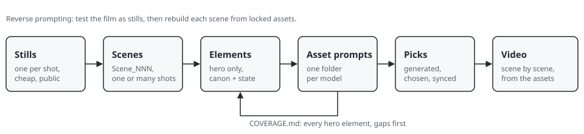

# Reverse Prompting Skill.md

<p align="center">
  
  &nbsp;
  
  &nbsp;
  
  &nbsp;
  
  &nbsp;
  <a href="LICENSE"></a>
  &nbsp;
  <a href="CHANGELOG.md"></a>
</p>

<p align="center">
  
</p>

**reverse-prompting** is an Agent Skill for AI filmmakers who test a film as cheap stills, one generated frame per shot, and then take each still apart into the assets a costly video model needs: character and extras sheets, costumes, props, vehicles and empty plates of each place. The assets are filed scene by scene, written as prompt files per model, counted so nothing is lost, picked, and only then used to generate video, one shot or a run of shots per scene.

## Install

```bash
npx skills@1.7.6 add vivid-allusion/reverse-prompting-skill
```

That installs the skill with the [`npx skills`](https://www.npmjs.com/package/skills) CLI, pinned to the version this route was proven on. To see what it would install without installing, add `-l`.

It needs Node and npm and a machine that is online. Nothing else is needed: the skill is plain text and three standard-library Python scripts, and it installs no packages and needs no keys. The copy is frozen at install time: run the line again to update.

## What it covers

| Stage | What the skill gives the session |
|---|---|
| **Stills to scenes** | A shots table (shot, scene, still, old motion line) turned into `MAP/SCENES/Scene_NNN/SCENE.md` and `SHOT_NNN.md` by `scaffold.py`. A scene is one continuous place and time, of one shot or many. |
| **Reading a still** | A literal inventory, what is out of frame by its effect, and the hero of the shot. The still is a storyboard, not a look. |
| **Elements** | Only the hero and what a prominent character handles, wears or rides get an asset. Every element under `02_PRE-PRODUCTION/<category>/Scene_NNN/@NAME/`; a recurring one also under `_CANON/@NAME/`. |
| **Asset prompts** | One folder per model: plates in Seedream and GPT Image, props and vehicles in Seedream, extras in GPT Image with the still as costume reference, video prompts in `PROMPTS/VIDEO/`, written for Seedance 2.5. Sheets in overcast daylight on grey concrete. |
| **Coverage** | `coverage.py` rebuilds `MAP/COVERAGE.md`: every hero element with its prompt file or a stated reason, the missing ones first. |
| **Picks and video** | Picks get public addresses and go into the slots; video prompts rebuild each scene from them. |

It points to the skills it works beside rather than repeating them: `cinematic-realism` for the prompt method, `prompt-craft-character-sheet` and `prompt-craft-extras-sheet` for the sheets, `helmer-md` for prompt-file syntax and `helmer-story-breakdown` for categories and naming. All of them live in the `vivid-allusion` organisation on GitHub; `tools/check_names.py` and `tools/check_evidence.py` take the paths of their checkouts.

## Versions

| Skill | Written for | Notes |
|---|---|---|
| 0.1.1 | Seedance 2.5 | Current. Video prompts are written for Seedance 2.5; the folder stays `VIDEO/`. |
| 0.1.0 | Seedance 2.5 | First version. Evals written, not yet graded in real-model sessions. |

## Layout

| Path | Is |
|---|---|
| `skills/reverse-prompting/SKILL.md` | The skill. Under 500 lines; detail is in `references/`, loaded on demand. |
| `skills/reverse-prompting/references/` | One topic per page. Start at `INDEX.md`. |
| `skills/reverse-prompting/scripts/` | `scaffold.py`, `coverage.py`, `check_prompts.py`, and their shared `rp_lib.py`. |
| `skills/reverse-prompting/evals/` | Trigger cases and task cases, with the checks they must pass. |
| `skills/reverse-prompting/CHANGELOG.md` | The skill's own record of every change. |
| `examples/the-last-ferry/` | An invented three-scene film, one scene of three shots, from its shots table to its video prompts. The tests run against it. |
| `docs/walkthrough.md` | The example film, step by step. |
| `assets/` | The picture on this page. See [`assets/SOURCES.md`](assets/SOURCES.md). |
| `tools/validate.py`, `tests/` | This repo's gate, run on every push. |
| `tools/check_names.py`, `tools/check_evidence.py` | Check every named file and folder, and the evals' answers, against this repo and the sibling skills. |
| `tools/evalrun/` | Runs the evals in real-model sessions in throwaway copies of the example film, and grades them. |

## Working on it

```bash
python3 -B tools/validate.py
python3 -B -m unittest discover -s tests
python3 -B tools/check_names.py --tree ../helmer-story-breakdown-skill --tree ../helmer-md-skill --tree ../cinematic-realism-skill --tree ../prompt-craft-character-sheet-skill --tree ../prompt-craft-extras-sheet-skill
python3 -B tools/check_evidence.py --tree helmer-md=../helmer-md-skill --tree cinematic-realism=../cinematic-realism-skill --tree prompt-craft-extras-sheet=../prompt-craft-extras-sheet-skill
```

A change to the skill is a line in `skills/reverse-prompting/CHANGELOG.md` and a new `metadata.version` in `SKILL.md`; the gate refuses a mismatch, and refuses a badge or a version row on this page that no longer matches the skill. When a script changes, rebuild the example with `coverage.py` and commit what it writes: the tests compare it.

## Licence

[MIT License](LICENSE) · Copyright © 2026 Vivid Allusion
